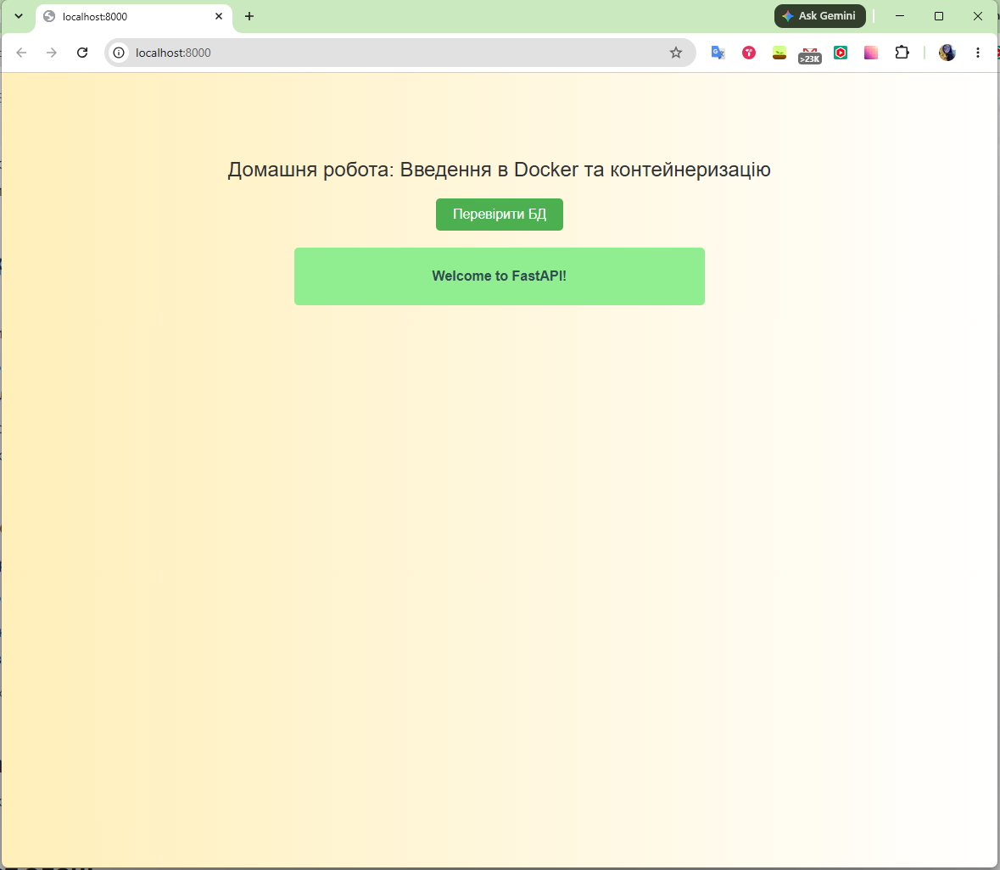

# FastAPI та PostgreSQL у Docker

Збірка й запуск застосунку та бази даних:

```bash
docker-compose up --build
```

Відкрийте http://localhost:8000 і натисніть **«Перевірити БД»**, щоб перевірити підключення до PostgreSQL.

Зупинка: натисніть `Ctrl+C`, потім виконайте:

```bash
docker-compose down
```

## Результат


